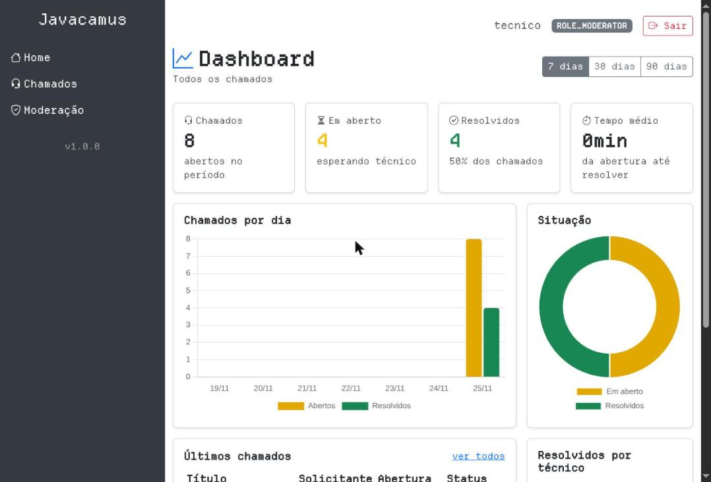

<h1 align="center"> 
	🍃 Javacamus - Controle de chamados técnicos 🍃
</h1>

<p align="center">
  
</p>

---

## 🌳 Sobre o projeto

Javacamus é um sistema de **controle de chamados técnicos** feito com **Java + Spring Boot**, **Thymeleaf** e **MongoDB Atlas**, baseado no Thindesk apresentado em sala.

Ele começou como um template de autenticação e autorização (login, logout, recuperação de senha, cadastro de usuários e controle de acesso por perfil com **Spring Security**) e agora está integrado ao microserviço [chamados-ms](https://github.com/0LucasMatheus/chamados-ms), que cuida da abertura, consulta e resolução dos chamados.

O Javacamus é quem tem as telas e o login. Os chamados ficam no microserviço, que não tem tela nem login próprios: ele só aceita requisições com um **JWT** que o Javacamus gera para o usuário logado.

---

## 🔑 Acesse

**Aplicação:** [link do deploy](https://javacamus.exemplo.com)

Qualquer pessoa pode entrar com uma das contas de demonstração:

| Perfil | Usuário | Senha | O que dá pra fazer |
|---|---|---|---|
| Técnico | `tecnico` | `tecnico123` | ver todos os chamados, resolver e ver o dashboard geral |
| Usuário | `usuario` | `usuario123` | abrir chamados e acompanhar os seus |
| Admin | `admin` | `admin123` | tudo do técnico + cadastro de usuários |

> As contas de demonstração são criadas na primeira vez que a aplicação sobe e ficam travadas: não dá pra editar nem excluir pela tela, assim ninguém tira o acesso de quem vem depois.

---

## 🏷️ Versão

Versão atual: **1.0.0**

O projeto segue o [Versionamento Semântico (SemVer)](https://semver.org/lang/pt-BR/), no formato `MAJOR.MINOR.PATCH`:

| Parte | Quando sobe | Exemplo |
|---|---|---|
| `MAJOR` | mudança que quebra o que já existia (rota que muda, dado que muda de formato) | `1.4.2` → `2.0.0` |
| `MINOR` | funcionalidade nova que não quebra nada | `1.0.0` → `1.1.0` |
| `PATCH` | correção ou ajuste sem funcionalidade nova | `1.1.0` → `1.1.1` |

Enquanto a versão começa com `0` (`0.x.y`), o sistema ainda está em desenvolvimento e pode mudar a qualquer momento. A `1.0.0` é a primeira versão entregue e estável.

Também dá para usar um sufixo de pré-lançamento, como `1.1.0-beta`, numa versão que ainda está sendo testada antes da oficial.

A versão fica só no `pom.xml`. O Spring Boot copia ela para o `application.properties` na hora do build (`app.versao=@project.version@`), e ela aparece na tela de login e na sidebar.

### Histórico

| Versão | O que entrou |
|---|---|
| `0.1.0` | usuários de demonstração criados no boot e protegidos |
| `0.2.0` | geração do JWT e integração com o microserviço de chamados |
| `0.3.0` | telas de abrir, listar e resolver chamados |
| `0.4.0` | dashboard de chamados na home |
| `0.4.1` | Dockerfile para o deploy |
| `1.0.0` | versão de entrega, com a versão na tela |

---

## 📊 Dashboard

A home é o dashboard. O técnico e o admin veem os números de todos os chamados, e o usuário comum vê só os dele.

- Cards com total de chamados, em aberto, resolvidos (e a % resolvida) e tempo médio entre abrir e resolver
- Gráfico de barras com os chamados abertos e resolvidos por dia
- Rosca com a situação dos chamados
- Últimos 5 chamados e quantos cada técnico resolveu
- Filtro de período: 7, 30 ou 90 dias

<p align="center">
  
</p>

---

## 🔧 Funcionalidades

#### Chamados
- [x] Usuário abre um chamado com título e descrição
- [x] Solicitante, data de abertura e status `ABERTO` preenchidos pelo microserviço
- [x] Usuário vê só os próprios chamados, técnico e admin veem todos
- [x] Filtro por status na lista
- [x] Técnico registra a solução, o chamado vira `RESOLVIDO` com a data e quem resolveu
- [x] Chamado resolvido não pode ser resolvido de novo

#### Usuários
- [x] Login, logout e recuperação de senha por código no e-mail
- [x] Cadastro, edição e exclusão de usuários (só admin)
- [x] Contas de demonstração travadas

---

## 🛡️ Perfis de acesso (Roles)

| Perfil | Pode acessar | Permissões no microserviço |
|---|---|---|
| `ADMIN` | tudo, incluindo `/admin/**` e a API `/api/usuarios` | `chamados:abrir`, `chamados:resolver` |
| `MODERATOR` (técnico) | chamados, dashboard geral e `/moderator/**` | `chamados:abrir`, `chamados:resolver` |
| `USER` | chamados e dashboard só dos próprios | `chamados:abrir` |

A autorização das telas fica em `SecurityConfig` e nos `sec:authorize` das views. Quem tenta acessar uma rota sem permissão cai na página `/acesso-negado` (HTTP 403).

---

## 🔗 Integração com o microserviço

O microserviço não sabe o que é perfil, ele só entende permissões. Por isso o `TokenService` traduz o perfil do usuário logado em permissões e gera um JWT (HS256) assinado com o `JWT_SECRET`, que é o mesmo nos dois projetos:

```json
{
  "sub": "id-do-usuario-no-mongo",
  "nome": "usuario",
  "permissoes": ["chamados:abrir"]
}
```

O `ChamadoService` usa um `RestClient` do Spring para chamar o microserviço, sempre com o header `Authorization: Bearer <token>`. O token vale 5 minutos e é gerado de novo a cada requisição. Os erros que o microserviço devolve (403, 404, 409) viram mensagens na tela.

```
navegador ──login/sessão──▶ javacamus ──JWT──▶ chamados-ms
                               │                    │
                               ▼                    ▼
                         Atlas (usuarios)     Atlas (chamados)
```

---

## 🍃 MongoDB Atlas

O Javacamus guarda os usuários na coleção `usuarios`, e o chamados-ms guarda os chamados na coleção `chamados`. Os dois usam o **MongoDB Atlas**, cada um com o seu banco. A string de conexão vem da variável `MONGODB_URI`:

```properties
spring.data.mongodb.uri=${MONGODB_URI}
spring.data.mongodb.database=${MONGODB_DATABASE}
```

Para criar o cluster:
1. Crie uma conta gratuita em [mongodb.com/cloud/atlas](https://www.mongodb.com/cloud/atlas) e um cluster M0.
2. Em **Database Access**, crie um usuário com senha.
3. Em **Network Access**, libere o IP da sua máquina e o da VPS.
4. Em **Connect → Drivers**, copie a connection string (`mongodb+srv://...`).

A senha do usuário é salva só como hash BCrypt.

---

## 🦈 Como executar o projeto

### Pré-requisitos

- [Git](https://git-scm.com)
- [Nix + devenv](https://devenv.sh/getting-started/) (gerencia o JDK 21 e o Maven)
- Um cluster no [MongoDB Atlas](https://www.mongodb.com/cloud/atlas)
- O [chamados-ms](https://github.com/0LucasMatheus/chamados-ms) rodando
- Uma conta de e-mail com senha de app, para a recuperação de senha

---

**1 - Clonar os dois projetos lado a lado**
```bash
git clone https://github.com/0LucasMatheus/javacamus.git
git clone https://github.com/0LucasMatheus/chamados-ms.git
```

**2 - Subir o microserviço na porta 8081** (seguindo o README dele)
```bash
cd chamados-ms
devenv shell
mvn spring-boot:run -Dspring-boot.run.arguments=--server.port=8081
```

**3 - Configurar o `.env` do Javacamus**
```bash
cd javacamus
cp .env.example .env
# preencha com os valores reais
```

| Variável | Pra que serve |
|---|---|
| `MONGODB_URI` / `MONGODB_DATABASE` | conexão com o Atlas |
| `ADMIN_*`, `TECNICO_*`, `USUARIO_*` | usuário, senha e e-mail das contas de demonstração |
| `MAIL_USERNAME` / `MAIL_PASSWORD` | e-mail que manda o código de recuperação de senha |
| `JWT_SECRET` | **o mesmo** do chamados-ms, mínimo 32 caracteres |
| `CHAMADOS_URL` | endereço do microserviço (`http://localhost:8081` no local) |

> Se o `JWT_SECRET` for diferente nos dois projetos, as telas de chamados mostram "Serviço de chamados indisponível", porque o microserviço recusa o token com 401.

**4 - Subir a aplicação**
```bash
devenv shell
devenv up
# ou mvn spring-boot:run
```

**5 - Acessar** http://localhost:8080/login com uma das contas do `.env`

---

## 🚀 Deploy (Dokploy)

Os dois projetos têm um `Dockerfile` (build com Maven e execução com JRE 21, no fuso de Brasília). No Dokploy, crie um projeto e dentro dele duas aplicações apontando para o GitHub, com **Build Type: Dockerfile**:

**1 - Aplicação `chamados-ms`**
- Repositório `chamados-ms`, branch `main`
- Variáveis: `MONGODB_URI`, `MONGODB_DATABASE`, `JWT_SECRET`
- Não precisa de domínio: só o Javacamus chama ele, pela rede interna do Dokploy

**2 - Aplicação `javacamus`**
- Repositório `javacamus`, branch `main`
- Variáveis: as mesmas do `.env.example`, com `CHAMADOS_URL=http://<app name do chamados-ms>:8080`
- Domínio apontando para a porta `8080`

> O `CHAMADOS_URL` usa o **App Name** que o Dokploy mostra na aplicação do microserviço (algo como `javacamus-chamadosms-abc123`), não o nome que você digitou. Se usar o nome errado, as telas de chamados mostram "Serviço de chamados indisponível".

---

## 🎣 Tecnologias

#### **Ambiente de desenvolvimento**
- **[devenv](https://devenv.sh)** (Nix): JDK 21 e Maven

#### **Back-End**
- [Java 21](https://www.oracle.com/java/) + [Spring Boot 3](https://spring.io/projects/spring-boot)
- [Spring Security](https://spring.io/projects/spring-security): autenticação e autorização
- [Spring Security OAuth2 JOSE](https://docs.spring.io/spring-security/reference/servlet/oauth2/resource-server/jwt.html): geração do JWT
- [RestClient](https://docs.spring.io/spring-framework/reference/integration/rest-clients.html): chamadas ao microserviço
- [Spring Data MongoDB](https://spring.io/projects/spring-data-mongodb)
- [Spring Mail](https://docs.spring.io/spring-framework/reference/integration/email.html): código de recuperação de senha

#### **Front-End**
- [Thymeleaf](https://www.thymeleaf.org/) + [thymeleaf-extras-springsecurity6](https://github.com/thymeleaf/thymeleaf-extras-springsecurity) + [thymeleaf-layout-dialect](https://github.com/ultraq/thymeleaf-layout-dialect)
- [Bootstrap 5](https://getbootstrap.com/) + [Bootstrap Icons](https://icons.getbootstrap.com/)
- [Chart.js 4](https://www.chartjs.org/): gráficos do dashboard

#### **Banco de dados**
- [MongoDB Atlas](https://www.mongodb.com/cloud/atlas)

#### **Deploy**
- [Docker](https://www.docker.com/) + [Dokploy](https://dokploy.com/) numa VPS

---
